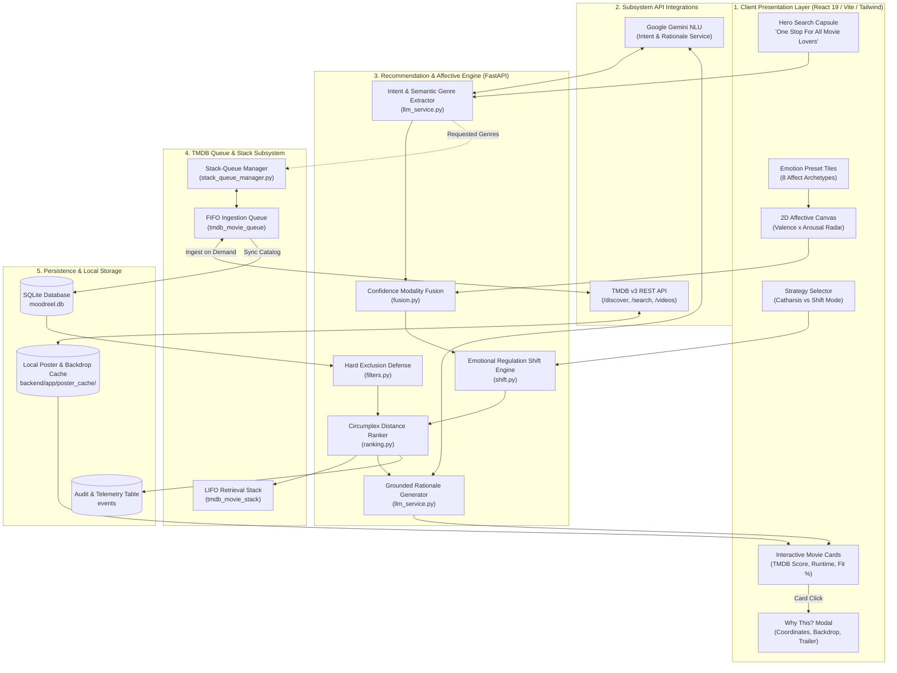

# IMR: Internet Movie Recommender

> **One Stop For All Movie Lovers**  
> *Affective Psychology • TMDB On-Demand Ingestion • FIFO Queue & LIFO Stack Caching • Circumplex Mood Modeling • Zero Hallucinations*

**IMR (Internet Movie Recommender)**, powered by the **MoodReel** engine, is an intelligent cinematic discovery platform that maps natural-language emotional reflections and explicit 2D mood coordinates into formal psychological affect space (**Russell’s Circumplex Model of Affect: Valence $\times$ Arousal**). It pairs psychological states with rich, verified metadata dynamically abstracted from **The Movie Database (TMDB)**.

Using an on-demand **FIFO Queue $\to$ Persistent SQLite $\to$ LIFO Stack** architecture, IMR streams and caches movie data, theatrical one-sheet posters, backdrop imagery, live TMDB ratings, cast/director metadata, and official YouTube trailers—guaranteeing high-speed retrieval with zero redundant external API calls.

---

## Table of Contents

- [Core Capabilities](#core-capabilities)
- [System Architecture (Layered)](#system-architecture-layered)
- [Workflow Architecture](#workflow-architecture)
  - [Module 1: Multimodal Mood Discovery & Intent Extraction](#module-1-multimodal-mood-discovery--intent-extraction)
  - [Module 2: Dynamic TMDB Queue-Stack Ingestion](#module-2-dynamic-tmdb-queue-stack-ingestion)
  - [Module 3: Circumplex Affective Matching & Regulation](#module-3-circumplex-affective-matching--regulation)
- [Chromotherapeutic Dynamic Theming](#chromotherapeutic-dynamic-theming)
- [Compliance & Privacy by Design](#compliance--privacy-by-design)
- [Diagnostic & Health Monitoring](#diagnostic--health-monitoring)
- [Repository Structure](#repository-structure)
- [Getting Started](#getting-started)
  - [Prerequisites](#prerequisites)
  - [Installation](#installation)
  - [Environment Setup](#environment-setup)
  - [Running Locally](#running-locally)
- [Deployment & Live App](#deployment--live-app)
- [Automated Testing](#automated-testing)
- [License](#license)

---

## Core Capabilities

- **Multimodal Emotional Input:** Express mood through natural language reflection prompts (*"long exhausting week, need something comforting yet visually awe-inspiring"*), 8 curated affect archetype preset tiles, or interactive 2D coordinates on the Russell Circumplex Affective Canvas.
- **Cognitive Intent Extraction:** Powered by Google Gemini NLU to parse unstructured text into 2D affect coordinates (Valence $v \in [-1.0, 1.0]$, Arousal $a \in [-1.0, 1.0]$) alongside extracted genre desires.
- **On-Demand TMDB Dynamic Abstraction:** Movies are abstracted dynamically per requested genre through a FIFO ingestion queue into local storage, eliminating redundant external API queries.
- **High-Throughput LIFO Retrieval Stack:** Automatically tracks session genre explorations and pushes recommendations onto an in-memory/DB LIFO stack for immediate traversal.
- **Interactive Clickable Movie Cards:** Cards display theatrical one-sheet posters, match fit percentages, origin badges, runtimes, release years, and live TMDB rating badges (e.g., ⭐ `8.4` TMDB). Clicking any card opens a full transparency modal.
- **Deep Transparency Modal ("Why this recommendation?"):** Provides mathematical explainability showing Russell's affective coordinates, Euclidean distance calculations, Gemini-generated rationale narratives, official YouTube trailers, and filter verification audits.
- **Dual Emotional Strategies (Catharsis vs. Shift Mode):**
  - *Catharsis Mode:* Meets users exactly where they are, validating current emotional states ($\vec{M}_{\text{target}} = \vec{M}_{\text{user}}$).
  - *Shift Mode:* Gently calculates an emotional regulation trajectory toward calming warmth and equilibrium ($v = +0.40, a = -0.10$).
- **Deterministic Zero-Hallucination Catalog:** Recommendations are grounded strictly in catalog records verified against TMDB; the AI never invents fictitious movies or synthetic scores.

---

## System Architecture (Layered)

IMR is built in five distinct functional layers, ensuring modularity, clean separation of concerns, and robust error isolation.



### Layer Breakdown

1. **Client Presentation Layer:** High-performance React application utilizing glass-light morphism, chromotherapeutic dynamic color themes, CSS hardware-accelerated transforms, and mobile-responsive viewport scaling.
2. **Subsystem API Integrations:** Resilient integrations with Google Gemini for affective intent analysis and The Movie Database (TMDB) for authentic cinema metadata. Includes an automatic `httpx` to `curl.exe` fallback preventing Windows TLS handshake socket drops.
3. **Recommendation & Affective Engine:** The core mathematical pipeline running on FastAPI that handles intent parsing, confidence-weighted vector fusion, trajectory calculation, filter evaluation, and Euclidean distance sorting.
4. **TMDB Queue & Stack Subsystem:** Manages asynchronous on-demand data extraction via FIFO queues and fast retrieval via LIFO stacks.
5. **Persistence & Local Storage Layer:** Local SQLite database storing catalog metadata, genre relationships, user feedback logs, and a local file cache of high-resolution theatrical one-sheets.

---

## Workflow Architecture

### Module 1: Multimodal Mood Discovery & Intent Extraction

Transforms unstructured natural language text and canvas coordinates into a unified affective vector:

```
[User Input: Text / Canvas]
         │
         ├── Text Reflection ──────────► [Gemini NLU / Regex Lexicon] ──► Vector Mt (v, a), Conf: 0.75
         └── 2D Canvas Position ──────────────────────────────────────► Vector Mc (v, a), Conf: 1.00
                                                                                   │
                                                                                   ▼
                                                                      [Modality Fusion Centroid]
                                                                      Mfused = Σ(ci · Mi) / Σ(ci)
```

1. **Stage 1 (Input Ingestion):** User submits text reflection, selects an emotional preset, or adjusts the 2D affect radar.
2. **Stage 2 (NLP Analysis):** Gemini parses sentiment, determining valence ($v \in [-1.0, 1.0]$), arousal ($a \in [-1.0, 1.0]$), confidence, and desired genres.
3. **Stage 3 (Modality Fusion):** Merges text and canvas inputs using confidence-weighted centroid computation:
   $$\vec{M}_{\text{fused}} = \frac{\sum c_i \cdot \vec{M}_i}{\sum c_i}$$

---

### Module 2: Dynamic TMDB Queue-Stack Ingestion

Eliminates repetitive third-party API queries by maintaining an on-demand abstraction pipeline:

```
User Query (e.g., "Cyberpunk Sci-Fi")
         │
         ▼
[Check Local Catalog DB]
         │
         ├── [Sufficient Records Exist] ──► Proceed to Circumplex Ranking
         │
         └── [Needs Fresh Titles]
                  │
                  ▼
         [Enqueues into FIFO Queue (tmdb_movie_queue)]
                  │
                  ▼
         [TMDB v3 API Request (/discover/movie, /videos)]
                  │
                  ▼
         [Persist to DB & Download Poster to Local Cache]
                  │
                  ▼
         [Push to LIFO Stack (tmdb_movie_stack)]
```

1. **Stage 1 (Cache Check):** Verifies if the local catalog contains enough matching candidates for the requested genre.
2. **Stage 2 (FIFO Queue Ingestion):** Unseen genres are enqueued into `tmdb_movie_queue` for batch ingestion.
3. **Stage 3 (TMDB Enrichment):** Retrieves vote averages, vote counts, high-resolution one-sheet posters (`w780`), widescreen backdrops (`w1280`), top cast, director, and official trailer URLs.
4. **Stage 4 (LIFO Stack Push):** The absorbed titles are pushed onto `tmdb_movie_stack`, establishing a fast-access cache for recent queries.

---

### Module 3: Circumplex Affective Matching & Regulation

Ranks verified catalog titles according to geometric affective proximity:

1. **Stage 1 (Regulation Trajectory):**
   - *Catharsis:* $\vec{M}_{\text{target}} = \vec{M}_{\text{fused}}$
   - *Shift Mode:* $\vec{M}_{\text{target}} = \vec{M}_{\text{fused}} + 0.55 \cdot (\vec{M}_{\text{equilibrium}} - \vec{M}_{\text{fused}})$
2. **Stage 2 (Hard Exclusions):** Eliminates titles violating maximum runtime limits or user-excluded genres.
3. **Stage 3 (Euclidean Distance Ranking):** Computes distance in Russell's 2D space:
   $$\text{dist}(m, \text{target}) = \sqrt{(v_m - v_{\text{target}})^2 + (a_m - a_{\text{target}})^2}$$
   $$\text{MoodFit}(m) = \max\left(0, 1.0 - \frac{\text{dist}(m, \text{target})}{2\sqrt{2}}\right)$$
4. **Stage 4 (Cold-Start Weighting):**
   $$\text{Score} = w_{\text{mood}} \cdot \text{MoodFit} + w_{\text{taste}} \cdot \text{TasteFit}$$
   - New profiles ($\le 3$ ratings): $w_{\text{mood}} = 0.90, w_{\text{taste}} = 0.10$
   - Established profiles ($> 3$ ratings): $w_{\text{mood}} = 0.70, w_{\text{taste}} = 0.30$
5. **Stage 5 (Grounded Rationale):** Generates concise explanations highlighting how the title's affective atmosphere mirrors or comforts the user's emotional state.

---

## Chromotherapeutic Dynamic Theming

The user interface automatically adapts its luminous glassmorphic palette according to the user's emotional state and strategy mode:

| Detected Mood | Therapeutic UI Theme | Ambient Palette | Psychological Objective |
|---|---|---|---|
| **Sad / Depressed** | Gentle Solace | Sage Green (`#9CAF88`), Pale Sky (`#A8D0E6`) | Alleviates emotional fatigue; evokes freshness, safety, and breathing room. |
| **Stressed / Anxious** | Tranquil Horizon | Dusty Lavender (`#B8A9C9`), Soft Slate (`#76A5AF`) | Lowers visual clutter and induces grounding. |
| **Energetic / Joyful** | Warm Radiance | Sunburst Peach (`#FFAB76`), Warm Amber (`#F4C430`) | Sustains positive arousal without harsh, fatiguing saturation. |
| **Bored / Lethargic** | Invigorating Coral | Coral Rose (`#F07167`), Mint Teal (`#00AFB9`) | Stimulates sensory focus and sparks curiosity. |
| **Angry / Agitated** | Cool Balance | Forest Moss (`#4A6B53`), Deep Navy (`#1B263B`) | Cooling earth tones to neutralize high-arousal states. |

*Palettes transition smoothly via CSS `1.8s cubic-bezier(0.4, 0, 0.2, 1)` transitions, meeting WCAG AA contrast standards.*

---

## Compliance & Privacy by Design

- **Sensor-Free Architecture:** MoodReel does **not** access webcams, facial emotion recognition (FER) models, microphones, or biometric trackers. All emotional inputs are voluntary and explicit.
- **Strict One-Way Pipeline:** The LLM interprets only user prompts and generates rationale text. It is never fed user listening/viewing history for persistent profiling.
- **Pseudonymous Sessions:** User identity is represented by random client-generated session keys (`sess_anon_...`). No account creation, email address, or personally identifiable information (PII) is ever collected.
- **1-Click Local Data Erasure:** Users can erase all session history, mood coordinates, and interaction logs at any time from the Consent & Transparency Center.

---

## Diagnostic & Health Monitoring

Dedicated diagnostic endpoints allow inspection of the internal data pipelines:

| Endpoint | Method | Description |
|---|---|---|
| `/health` | `GET` | Health status of backend services and SQLite database connectivity. |
| `/api/catalog/tmdb-status` | `GET` | Live TMDB API connectivity, masked key validation, sample query diagnostics, and poster cache coverage percentage. |
| `/api/catalog/stack-queue-status` | `GET` | Real-time queue and stack analytics: pending FIFO queue items, active LIFO stack depth, and genre breakdown. |
| `/api/recommend` | `POST` | Core affective recommendation endpoint taking target mood vectors, strategies, and optional filters. |
| `/api/feedback` | `POST` | Ingests 1-tap user feedback (`watched`, `helped`, `skipped`, `disliked`) to tune cold-start weights. |
| `/api/catalog/poster/{title_id}` | `GET` | Delivers verified local theatrical one-sheet posters. |

---

## Repository Structure

```
IMR-internet-movie-recommender-/
├── backend/
│   ├── app/
│   │   ├── api/
│   │   │   ├── routers/
│   │   │   │   ├── catalog.py          # Poster delivery, TMDB status, Stack-Queue diagnostics
│   │   │   │   ├── feedback.py         # 1-tap feedback collection
│   │   │   │   ├── mood.py             # NLP affect parsing & preset resolution
│   │   │   │   └── recommend.py        # Core recommendation pipeline & TMDB abstraction
│   │   │   └── api_router.py           # Unified route aggregator
│   │   ├── core/
│   │   │   ├── config.py               # Pydantic v2 application settings
│   │   │   ├── filters.py              # Runtime caps and genre hard exclusion filters
│   │   │   ├── fusion.py               # Confidence-weighted modality fusion
│   │   │   ├── llm_service.py          # Gemini NLU parsing & grounded rationale generator
│   │   │   ├── ranking.py              # Russell Circumplex Euclidean distance ranker
│   │   │   ├── shift.py                # Emotional regulation shift trajectory
│   │   │   ├── stack_queue_manager.py  # FIFO queue ingestion & LIFO retrieval stack
│   │   │   ├── tmdb_service.py         # TMDB API client, metadata enrichment & poster cache
│   │   │   └── weighting.py            # Dynamic cold-start vs established user weights
│   │   ├── db/
│   │   │   ├── models.py               # SQLAlchemy models (MovieTitle, Genre, TMDBQueue, etc.)
│   │   │   ├── seed_data.py            # Verified catalog seed generator
│   │   │   └── session.py              # SQLite engine & session management
│   │   ├── schemas/                    # Pydantic validation contracts
│   │   └── main.py                     # FastAPI application setup & CORS configuration
│   ├── poster_cache/                   # Locally cached high-res theatrical posters
│   ├── tests/                          # Pytest automated test suite
│   ├── requirements.txt                # Python backend dependencies
│   └── run_backend.py                  # Backend server launcher
│
├── frontend/
│   ├── src/
│   │   ├── components/
│   │   │   ├── filters/                # FilterDrawer (genre, runtime filters)
│   │   │   ├── mood/                   # MoodCanvas, EmotionPresets, StrategySelector
│   │   │   ├── results/                # MovieCard (interactive), WhyThisModal (full TMDB metrics)
│   │   │   └── safety/                 # ConsentNotice, PrivacyCenterModal
│   │   ├── services/
│   │   │   └── api.ts                  # Typed Axios/Fetch API client
│   │   ├── types.ts                    # TypeScript interface contracts & TMDB schemas
│   │   ├── utils/
│   │   │   └── theme.ts                # Chromotherapeutic theme palette engine
│   │   ├── App.tsx                     # Main application shell with centered hero capsule
│   │   ├── index.css                   # Tailwind CSS styling & glassmorphic tokens
│   │   └── main.tsx                    # React DOM entry point
│   ├── package.json                    # Frontend package dependencies & scripts
│   └── vite.config.ts                  # Vite build configuration
│
├── docs/                               # Architecture, config reference, privacy principles
├── LICENSE                             # MIT Open Source License
├── package.json                        # Root workspace configuration (concurrent dev scripts)
└── start_app.bat                       # Local development launcher script
```

---

## Getting Started

### Prerequisites

- **Python:** Version 3.10 or higher
- **Node.js:** Version 18.0 or higher
- **npm:** Version 9.0 or higher

---

### Installation

1. **Clone the repository:**
   ```bash
   git clone https://github.com/jedai11/IMR-internet-movie-recommender-.git
   cd IMR-internet-movie-recommender-
   ```

2. **Install root & frontend dependencies:**
   ```bash
   npm install
   npm --prefix frontend install
   ```

3. **Install backend Python dependencies:**
   ```bash
   cd backend
   python -m venv .venv
   # Windows PowerShell
   .\.venv\Scripts\Activate.ps1
   # macOS / Linux
   source .venv/bin/activate

   pip install -r requirements.txt
   cd ..
   ```

---

### Environment Setup

Create a `.env` file in the project root or in the `backend/` directory:

```env
# The Movie Database (TMDB) API Configuration
TMDB_API_KEY=your_tmdb_api_key_here
TMDB_IMAGE_BASE_URL=https://image.tmdb.org/t/p

# Optional Google Gemini Configuration (For NLP Affect Analysis & Rationale)
GEMINI_API_KEY=your_gemini_api_key_here
GEMINI_MODEL=gemini-3.5-flash
```

> **Note:** If no Gemini API key is provided, the platform automatically utilizes its high-speed local regex and heuristic affect lexicons with zero downtime.

---

### Running Locally

#### Option A: Concurrent Launch (Recommended)
From the project root:
```bash
npm run dev
```
Launches both the FastAPI backend and the Vite frontend concurrently.

#### Option B: Individual Services

1. **Start Backend (FastAPI):**
   ```bash
   cd backend
   python run_backend.py
   ```

2. **Start Frontend (Vite + React):**
   ```bash
   cd frontend
   npm run dev
   ```

#### Option C: Windows One-Click Launcher
Double-click `start_app.bat` or run:
```bat
start_app.bat
```

---

## Deployment & Live App

> **Live Deployment:** *Coming soon on Vercel.*  
> This section will be updated with the direct production URL upon deployment.

---

## Automated Testing

Run the full pytest suite to verify affective math, hard filters, and recommendation workflows:

```bash
cd backend
pytest -v
```

The automated test suite validates:
- Affective Euclidean distance calculations across Russell's 2D space
- Cold-start vs. established user weighting transitions
- Hard exclusion filters (runtime caps, genre exclusions)
- Health endpoints and recommendation pipeline assembly

---

## License

This project is licensed under the MIT License — see the [LICENSE](LICENSE) file for details.
