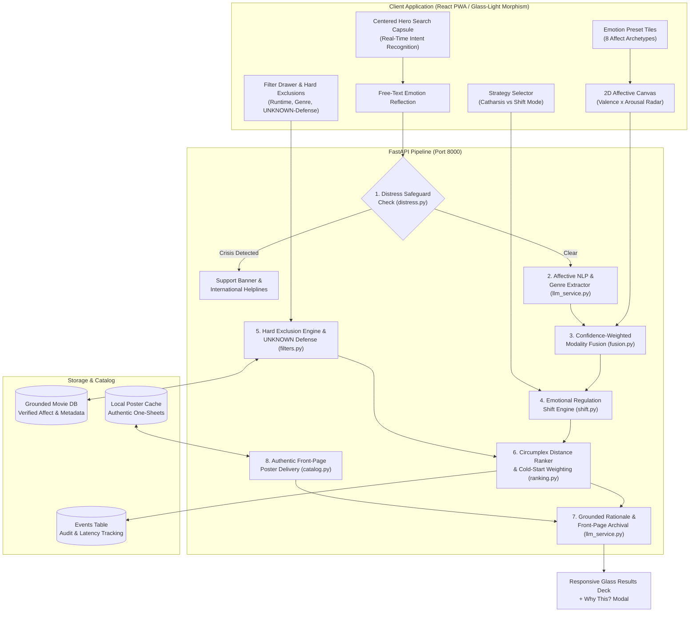

# IMR (Internet Movie Recommender) / MoodReel

> **Affective Psychology • Deterministic Grounded Catalog • Designed with Privacy & Transparency in Mind**

**IMR (Internet Movie Recommender)**, powered by the **MoodReel** engine, maps human emotional states into formal psychological affect space (**Russell’s Circumplex Model of Affect: Valence $\times$ Arousal**) and deterministically matches them against catalog titles with zero hallucinated movies.

---

## System Architecture



---

## Architectural Functions & Pipeline Execution

The system executes recommendations through eight formal stages:

### 1. Distress Safeguard Engine (`backend/app/core/distress.py`)
- **Function:** Immediate evaluation of free-text reflections for high-priority acute distress, crisis, or self-harm ideation before candidate retrieval.
- **Enforcement:** Uses compiled regex trees and keyword lexicons. If triggered, recommendation retrieval is bypassed immediately, returning supportive messaging, international 24/7 confidential helplines, and a gentle cinema alternative (ambient/nature documentaries).

### 2. Affective NLP & Semantic Genre Extractor (`backend/app/core/llm_service.py`)
- **Function:** Parses unstructured emotional text and movie genre intent into structured affect vectors $(v, a)$ and desired genre tags.
- **Enforcement:** Bounded to Google Gemini API (`gemini-3.5-flash` with zero-downtime tier routing) and high-speed local regex lexicons. Visual pills (`🎯 Thriller`, `✨ Nostalgic`) provide instant user feedback.

### 3. Confidence-Weighted Modality Fusion (`backend/app/core/fusion.py`)
- **Function:** Blends explicit canvas coordinates with NLP-extracted sentiment into a unified target mood vector.
- **Enforcement:** Explicit canvas inputs hold confidence $c=1.0$, while free-text extraction holds $c \in [0.4, 0.85]$. Fusion computes normalized confidence-weighted centroids:
  $$\vec{M}_{\text{fused}} = \frac{\sum c_i \cdot \vec{M}_i}{\sum c_i}$$

### 4. Emotional Regulation Shift Trajectory (`backend/app/core/shift.py`)
- **Function:** Calculates affective recommendation targets based on user strategy:
  - **Catharsis Mode:** Validates and mirrors current emotion ("Meet me where I am"). Target vector equals current user state ($\vec{M}_{\text{target}} = \vec{M}_{\text{user}}$).
  - **Shift Mode:** Generates a gentle regulation trajectory towards comforting warmth and equilibrium ($v_{\text{target}} = +0.40, a_{\text{target}} = -0.10$) using step factor $\lambda = 0.55$:
    $$\vec{M}_{\text{target}} = \vec{M}_{\text{user}} + \lambda \cdot (\vec{M}_{\text{equilibrium}} - \vec{M}_{\text{user}})$$

### 5. Hard Exclusion Engine & UNKNOWN-Metadata Defense (`backend/app/core/filters.py`)
- **Function:** Guarantees strict boundary compliance across maximum runtime, excluded genres, and user trigger warnings.
- **Enforcement:** When trigger exclusions are selected, any title with verified warnings *or unverified status (`UNKNOWN`)* is strictly dropped rather than assumed safe.

### 6. Circumplex Distance Ranker & Dynamic Weighting (`backend/app/core/ranking.py`, `weighting.py`)
- **Function:** Computes deterministic Euclidean distance ($L_2$ norm) across Russell's 2D Circumplex space:
  $$\text{dist}(m, \text{target}) = \sqrt{(v_m - v_{\text{target}})^2 + (a_m - a_{\text{target}})^2}$$
  $$\text{MoodFit}(m) = \max\left(0, 1.0 - \frac{\text{dist}(m, \text{target})}{2\sqrt{2}}\right)$$
- **Cold-Start Weighting:**
  $$\text{Score} = w_{\text{mood}} \cdot \text{MoodFit} + w_{\text{taste}} \cdot \text{TasteFit}$$
  - Cold-start ($\le 3$ interactions): $w_{\text{mood}} = 0.90, \, w_{\text{taste}} = 0.10$
  - Established profile ($> 3$ interactions): $w_{\text{mood}} = 0.70, \, w_{\text{taste}} = 0.30$

### 7. Grounded Rationale Generator (`backend/app/core/llm_service.py`)
- **Function:** Generates concise explanations highlighting how the title's affective atmosphere mirrors or soothes the user's emotional state.
- **Enforcement:** The LLM receives strictly verified title metadata; it never invents titles or computes recommendation scores.

### 8. Authentic Front-Page Poster Delivery (`backend/app/api/routers/catalog.py`)
- **Function:** Delivers verified theatrical one-sheet posters locally via `/api/catalog/poster/{title_id}` to prevent hotlink failures or CORS blocks.
- **Archival Verification:** The integrated Gemini archivist annotates each title's verified front-page cover, displayed inside the "Why this?" transparency modal.

---

## Chromotherapeutic Dynamic Theming

The user interface adapts its luminous glass-light ambient palette based on the user's emotional state, strategy mode, and detected mood archetype:

| Detected Mood | Therapeutic UI Theme | Color Palette | Psychological Objective |
|---|---|---|---|
| **Sad / Depressed** | Gentle Solace | Sage Green (`#9CAF88`), Pale Sky (`#A8D0E6`) | Alleviates emotional fatigue; evokes freshness, safety, and breathing room. |
| **Stressed / Anxious** | Tranquil Horizon | Dusty Lavender (`#B8A9C9`), Soft Slate (`#76A5AF`) | Lowers heart rate, reduces visual clutter, induces grounding. |
| **Energetic / Joyful** | Warm Radiance | Sunburst Peach (`#FFAB76`), Warm Amber (`#F4C430`) | Sustains positive arousal without harsh, fatiguing saturation. |
| **Bored / Lethargic** | Invigorating Coral | Coral Rose (`#F07167`), Mint Teal (`#00AFB9`) | Gently stimulates sensory focus and sparks curiosity. |
| **Angry / Agitated** | Cool Balance | Forest Moss (`#4A6B53`), Deep Navy (`#1B263B`) | Neutralizes aggressive stimuli with cooling earth tones. |

*Palettes transition smoothly via CSS `1.8s cubic-bezier(0.4, 0, 0.2, 1)` transitions, meeting WCAG AA contrast standards.*

---

## Crisis Helplines & Support Safeguards

If acute distress is detected, recommendations are bypassed immediately to display confidential support resources:

- **United States & Canada:** Call or text **988** ([988 Lifeline](https://988lifeline.org))
- **Crisis Text Line:** Text **HOME to 741741** (US & Canada) or **85258** (UK)
- **United Kingdom & Ireland:** Call **116 123** ([Samaritans](https://www.samaritans.org)) or **111** (NHS)
- **India:** Call **14416** ([Tele-MANAS](https://telemanas.mohfw.gov.in)) or **1800-599-0019** (KIRAN)
- **Worldwide:** Free confidential support in 130+ countries via [Find A Helpline](https://findahelpline.com) & [Befrienders Worldwide](https://www.befrienders.org)

---

## Quickstart Guide

### Prerequisites
- Python 3.10+
- Node.js 18+ & npm

### One-Click Launch (Windows)
Run the included launcher script:
```bat
start_app.bat
```
Starts the backend on `http://127.0.0.1:8000` and the frontend on `http://localhost:5173`.

### Manual Launch

#### 1. Backend (FastAPI)
```bash
cd backend
.\.venv\Scripts\Activate.ps1
python run_backend.py
```
- API Endpoint: **http://127.0.0.1:8000**
- Interactive Docs: **http://127.0.0.1:8000/docs**

#### 2. Frontend (React + Vite + Tailwind)
```bash
cd frontend
npm run dev
```
- Web Application: **http://localhost:5173**

---

## Running Automated Tests

Run the backend test suite verifying the pipeline functions, distress safeguard, UNKNOWN defense, and ranking math:

```bash
cd backend
.\.venv\Scripts\pytest -v
```

All 17 tests verify:
- Distress safeguard crisis phrase triggers and benign passes
- Hard filter runtime caps and genre exclusions
- Strict `UNKNOWN`-metadata exclusion defense
- Affective Euclidean distance calculation and cold-start weighting
- Health endpoint integrity and end-to-end recommendation assembly

---

## Project Structure

```
IMR-internet-movie-recommender-/
├── backend/
│   ├── app/
│   │   ├── api/routers/        # mood, recommend, feedback, catalog (poster server)
│   │   ├── core/               # distress safeguard, fusion, shift, filters, ranking, llm
│   │   ├── db/                 # models, session, seed catalog
│   │   ├── schemas/            # Pydantic v2 validation contracts
│   │   └── main.py             # FastAPI entrypoint + CORS + Lifespan
│   ├── poster_cache/           # Authentic theatrical one-sheet posters
│   ├── tests/                  # Pytest test suite (17 tests)
│   ├── requirements.txt
│   └── run_backend.py
│
├── frontend/
│   ├── src/
│   │   ├── components/
│   │   │   ├── mood/           # MoodCanvas, EmotionPresets, StrategySelector
│   │   │   ├── filters/        # FilterDrawer with UNKNOWN-defense toggle
│   │   │   ├── results/        # MovieCard, WhyThisModal (archival front-page badge)
│   │   │   └── safety/         # ConsentNotice, DistressBanner, PrivacyCenterModal
│   │   ├── services/api.ts     # Typed API client
│   │   ├── types.ts            # TypeScript contracts
│   │   ├── utils/theme.ts      # Chromotherapeutic theme palette engine
│   │   └── App.tsx             # Glass-light UI shell with centered search capsule
│   ├── package.json
│   └── vite.config.ts
│
├── docs/                       # Architecture, config reference, privacy principles
├── LICENSE                     # MIT Open Source License
└── start_app.bat               # Safe local launcher (127.0.0.1)
```

---

## License

This project is licensed under the MIT License — see the [LICENSE](LICENSE) file for details.
