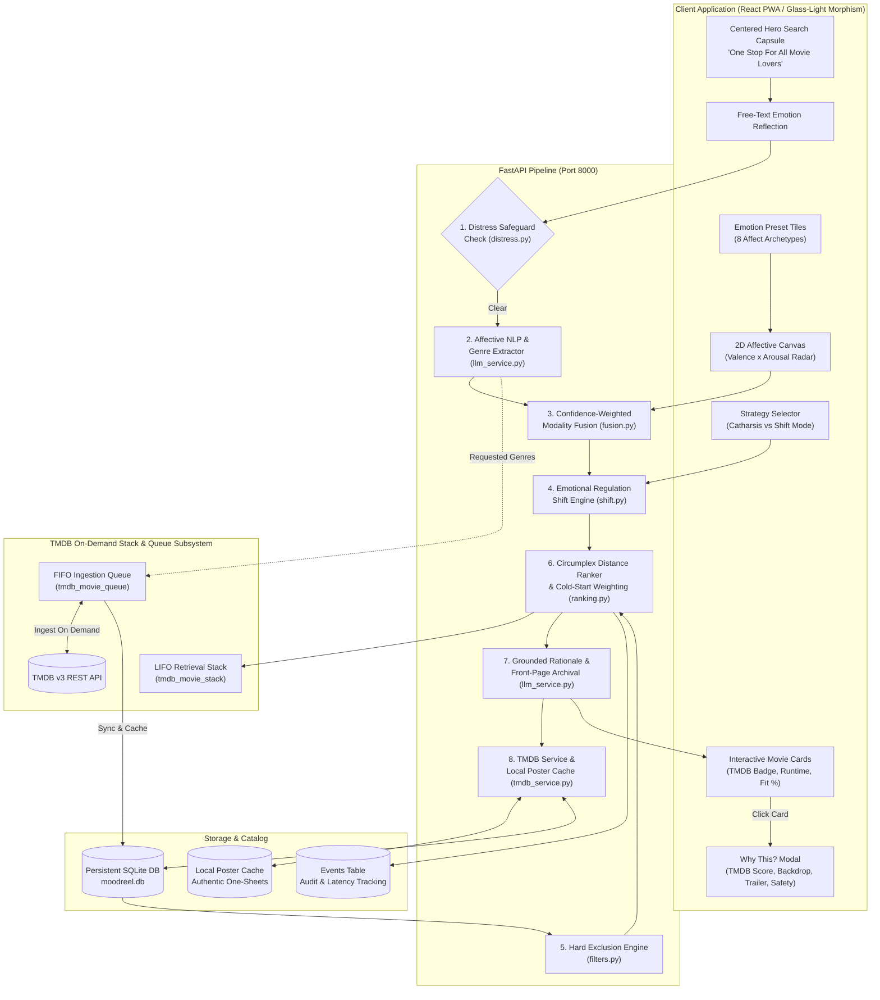

# IMR (Internet Movie Recommender) / MoodReel

> **One Stop For All Movie Lovers**  
> *Affective Psychology • The Movie Database (TMDB) Integration • Stack-and-Queue On-Demand Caching • Grounded Catalog*

**IMR (Internet Movie Recommender)**, powered by the **MoodReel** engine, is an intelligent cinema discovery platform that maps human emotional states into formal psychological affect space (**Russell’s Circumplex Model of Affect: Valence $\times$ Arousal**) and pairs them with rich, authentic metadata from **The Movie Database (TMDB)**.

By leveraging an on-demand **FIFO Queue $\to$ Persistent SQLite $\to$ LIFO Stack** architecture, IMR streams and caches movie data, high-resolution theatrical one-sheet posters, backdrop images, live TMDB ratings, cast/director information, and official trailers—ensuring instant retrieval without redundant external API requests.

---

## Key Features

- **One Stop For All Movie Lovers:** Seamlessly blends mood-based psychological discovery with real-time cinema metadata and trailers.
- **Russell's Circumplex Affective Model:** Deterministically calculates Euclidean distance across 2D Valence ($v$) and Arousal ($a$) coordinate space.
- **Dynamic TMDB On-Demand Abstraction:** Fetches and enriches movies per genre dynamically on user demand, abstracting data through a FIFO ingestion queue into local storage.
- **High-Performance LIFO Retrieval Stack:** Tracks user genre interactions and stores recent recommendations in a LIFO stack for rapid retrieval.
- **Interactive Clickable Movie Cards:** Cards feature high-res poster art, runtime, release year, origin tags, fit percentage, and verified TMDB rating badges. Clicking opens a full transparency modal.
- **Deep Transparency Modal ("Why this recommendation?"):** Displays affective coordinates, Euclidean distance math, LLM rationale, TMDB user score and vote counts, official YouTube trailer links, safety audit, and verified cover notes.
- **Distress Safeguard Engine:** Immediately evaluates user reflections for crisis keywords and displays 24/7 confidential international helpline resources when needed.
- **Chromotherapeutic Dynamic Theming:** The user interface dynamically shifts its luminous glassmorphic palette according to the user's emotional state.

---

## System Architecture



---

## TMDB Integration & Stack-Queue Architecture

The application interfaces directly with **The Movie Database (TMDB)** via `backend/app/core/tmdb_service.py` and `backend/app/core/stack_queue_manager.py`:

```
User Request (Genre / Mood)
         │
         ▼
[Check Local DB Cache] ──(Sufficient data exists)──► Skip External API Call
         │
    (Needs Data)
         ▼
[FIFO Queue: tmdb_movie_queue]
         │  Enqueues on-demand fetch task
         ▼
[TMDB API: /discover/movie & /search]
         │  Fetches metadata, high-res poster (w780), backdrop (w1280), videos
         ▼
[Database Ingestion]
         │  Persists to MovieTitle, Genre, Availability tables
         │  Caches poster locally in backend/app/poster_cache/
         ▼
[LIFO Stack: tmdb_movie_stack]
         │  Pushes title onto session/genre stack for rapid retrieval
         ▼
[Circumplex Affective Ranking & Response]
```

### Key Highlights:
1. **Zero Redundant Calls:** Once a genre's movies are abstracted into the local SQLite database and cached, subsequent recommendations use local data directly.
2. **Resilient Network Client:** Built with `httpx` with automatic `curl.exe` fallback to ensure zero connection resets on Windows environments.
3. **Rich Metadata Display:**
   - **User Score & Vote Count:** Verified TMDB rating badge (e.g., ⭐ `8.4` TMDB, `12,450 votes`).
   - **Backdrop Art:** Cinematic widescreen backdrops (`w1280`) integrated into movie previews.
   - **Official Trailers:** Direct one-click access to official YouTube trailers (`/videos` endpoint).
   - **Cast & Crew:** Extraction of primary cast members and directors.

---

## Diagnostic & Health Endpoints

IMR provides dedicated endpoints to monitor system health, database connections, and TMDB integration:

| Endpoint | Method | Description |
|---|---|---|
| `/health` | `GET` | Verifies API health, SQLite connectivity, and Gemini LLM status. |
| `/api/catalog/tmdb-status` | `GET` | Returns TMDB live connection status, masked API key preview, sample query results, and local poster cache coverage percentage. |
| `/api/catalog/stack-queue-status` | `GET` | Real-time diagnostics of the FIFO ingestion queue and LIFO retrieval stack (item counts, recent pushes, genre breakdown). |
| `/api/recommend` | `POST` | Core affective recommendation engine taking mood vectors, strategies, and optional filters. |
| `/api/feedback` | `POST` | Collects 1-tap feedback (`watched`, `helped`, `skipped`, `disliked`) to refine cold-start weights. |
| `/api/catalog/poster/{title_id}` | `GET` | Serves verified local theatrical one-sheet posters. |

---

## Chromotherapeutic Dynamic Theming

The user interface adapts its luminous glass-light ambient palette based on the user's emotional state, strategy mode, and detected mood archetype:

| Detected Mood | Therapeutic UI Theme | Color Palette | Psychological Objective |
|---|---|---|---|
| **Sad / Depressed** | Gentle Solace | Sage Green (`#9CAF88`), Pale Sky (`#A8D0E6`) | Alleviates emotional fatigue; evokes freshness, safety, and breathing room. |
| **Stressed / Anxious** | Tranquil Horizon | Dusty Lavender (`#B8A9C9`), Soft Slate (`#76A5AF`) | Lowers heart rate, reduces visual clutter, induces grounding. |
| **Energetic / Joyful** | Warm Radiance | Sunburst Peach (`#FFAB76`), Warm Amber (`#F4C430`) | Sustains positive arousal without harsh, fatiguing saturation. |
| **Bored / Lethargic** | Invigorating Coral | Coral Rose (`#F07167`), Mint Teal (`#00AFB9`) | Gently stimulates sensory focus and sparks curiosity. |
| **Angry / Agitated** | Cool Balance | Forest Moss (`#4A6B53`), Deep Navy (`#1B263B`) | Neutralizes aggressive stimuli with cooling earth tones. |

---

## Crisis Helplines & Support Safeguards

If acute distress is detected in the user's reflection, recommendation generation is immediately bypassed to display confidential support resources:

- **United States & Canada:** Call or text **988** ([988 Lifeline](https://988lifeline.org))
- **Crisis Text Line:** Text **HOME to 741741** (US & Canada) or **85258** (UK)
- **United Kingdom & Ireland:** Call **116 123** ([Samaritans](https://www.samaritans.org)) or **111** (NHS)
- **India:** Call **14416** ([Tele-MANAS](https://telemanas.mohfw.gov.in)) or **1800-599-0019** (KIRAN)
- **Worldwide:** Free confidential support in 130+ countries via [Find A Helpline](https://findahelpline.com) & [Befrienders Worldwide](https://www.befrienders.org)

---

## Quickstart Guide

### Prerequisites
- Python 3.10+
- Node.js 18+ & npm

### Environment Setup
Create a `.env` file in the project root or `backend/` directory:
```env
# TMDB API Configuration
TMDB_API_KEY=554ae6544a5de71241de6bb3c8d7b96a
TMDB_IMAGE_BASE_URL=https://image.tmdb.org/t/p

# Optional LLM Configuration for Rationale Generation
GEMINI_API_KEY=your_gemini_api_key_here
GEMINI_MODEL=gemini-3.5-flash
```

### One-Click Launch (Windows)
Run the included launcher script:
```bat
start_app.bat
```
Starts the backend on `http://127.0.0.1:8000` and the frontend on `http://localhost:5173`.

### Or Run via npm
```bash
npm run dev
```
Launches both frontend and backend concurrently.

### Manual Launch

#### 1. Backend (FastAPI)
```bash
cd backend
.\.venv\Scripts\Activate.ps1
python run_backend.py
```
- API Endpoint: **http://127.0.0.1:8000**
- Interactive Docs (Swagger): **http://127.0.0.1:8000/docs**

#### 2. Frontend (React + Vite + Tailwind)
```bash
cd frontend
npm run dev
```
- Web Application: **http://localhost:5173**

---

## Running Automated Tests

Run the test suite verifying the pipeline functions, distress safeguard, hard filters, and ranking mathematics:

```bash
cd backend
.\.venv\Scripts\pytest -v
```

All tests verify:
- Distress safeguard crisis phrase triggers and benign passes
- Hard filter runtime caps and genre exclusions
- Affective Euclidean distance calculation and cold-start weighting
- Health endpoint integrity and recommendation assembly

---

## Project Structure

```
IMR-internet-movie-recommender-/
├── backend/
│   ├── app/
│   │   ├── api/routers/
│   │   │   ├── catalog.py      # Poster server, TMDB status, Stack-Queue diagnostics
│   │   │   ├── feedback.py     # 1-tap feedback ingestion
│   │   │   ├── mood.py         # Affective NLP analysis & preset resolution
│   │   │   └── recommend.py    # Recommendation pipeline & on-demand TMDB abstraction
│   │   ├── core/
│   │   │   ├── config.py       # Configuration & environment settings
│   │   │   ├── distress.py     # Crisis safeguard engine
│   │   │   ├── filters.py      # Runtime & genre hard exclusion filters
│   │   │   ├── fusion.py       # Confidence-weighted modality fusion
│   │   │   ├── llm_service.py  # Gemini LLM affective parsing & rationale
│   │   │   ├── ranking.py      # Circumplex Euclidean distance ranker
│   │   │   ├── shift.py        # Emotional regulation shift trajectory
│   │   │   ├── stack_queue_manager.py # FIFO ingestion queue & LIFO retrieval stack
│   │   │   ├── tmdb_service.py # TMDB API client, metadata enrichment & poster cache
│   │   │   └── weighting.py    # Cold-start vs established user weights
│   │   ├── db/                 # SQLAlchemy models, SQLite session, seed catalog
│   │   ├── schemas/            # Pydantic v2 validation contracts
│   │   └── main.py             # FastAPI entrypoint + CORS + Lifespan
│   ├── poster_cache/           # Locally cached theatrical one-sheets
│   ├── tests/                  # Pytest test suite
│   ├── requirements.txt
│   └── run_backend.py
│
├── frontend/
│   ├── src/
│   │   ├── components/
│   │   │   ├── filters/        # FilterDrawer
│   │   │   ├── mood/           # MoodCanvas, EmotionPresets, StrategySelector
│   │   │   ├── results/        # MovieCard (clickable), WhyThisModal (TMDB details)
│   │   │   └── safety/         # ConsentNotice, DistressBanner, PrivacyCenterModal
│   │   ├── services/api.ts     # Typed API client
│   │   ├── types.ts            # TypeScript contracts & TMDB fields
│   │   ├── utils/theme.ts      # Chromotherapeutic theme palette engine
│   │   └── App.tsx             # Glass-light UI shell with centered search capsule
│   ├── package.json
│   └── vite.config.ts
│
├── docs/                       # Architecture, config reference, privacy principles
├── LICENSE                     # MIT Open Source License
├── package.json                # Root package with concurrent dev scripts
└── start_app.bat               # Safe local launcher (127.0.0.1)
```

---

## License

This project is licensed under the MIT License — see the [LICENSE](LICENSE) file for details.
