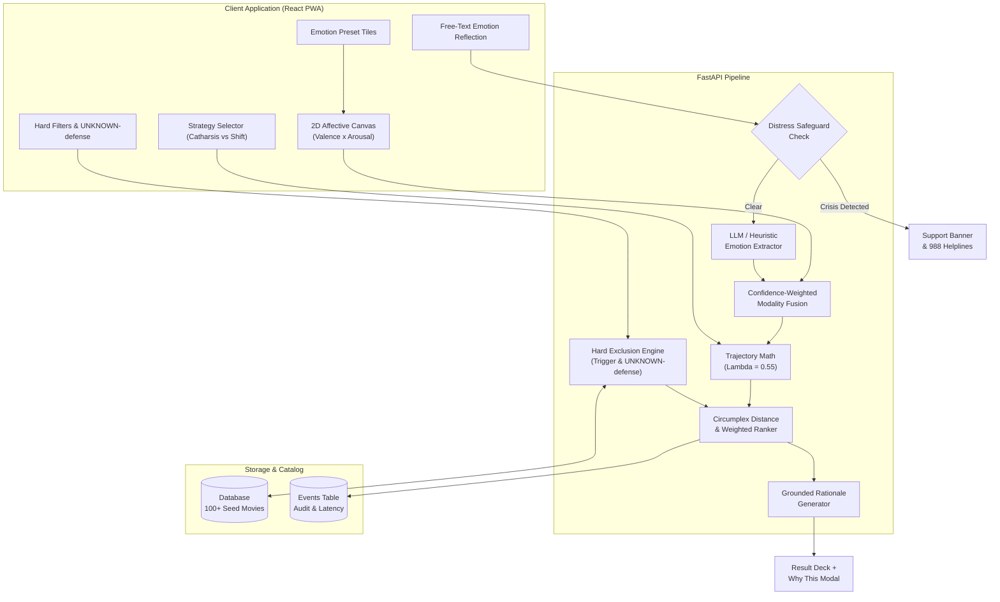

# IMR (Internet Movie Recommender) System Architecture

## 1. Architectural Overview

IMR (Internet Movie Recommender) operates on a hybrid architecture combining deterministic psychological affect computing with bounded, schema-validated language model assistance.

---

## 2. Mathematical Foundation

### Russell's Circumplex Affect Coordinates
Each item and state exists in continuous space:
$$M = (v, a) \quad v, a \in [-1.0, 1.0]$$
- **Valence ($v$):** Unpleasant ($-1.0$) to Pleasant ($+1.0$)
- **Arousal ($a$):** Deactivated / Low Energy ($-1.0$) to Activated / High Energy ($+1.0$)

### Distance and Fit Calculation
$$\text{dist}(m, \text{target}) = \sqrt{(v_m - v_{\text{target}})^2 + (a_m - a_{\text{target}})^2}$$
$$\text{MoodFit}(m) = \max\left(0, 1.0 - \frac{\text{dist}(m, \text{target})}{2\sqrt{2}}\right)$$

### Dynamic Cold-Start Weighting
$$\text{Score} = w_{\text{mood}} \cdot \text{MoodFit} + w_{\text{taste}} \cdot \text{TasteFit}$$
- $\le 3$ interactions: $w_{\text{mood}} = 0.90, \, w_{\text{taste}} = 0.10$
- $> 3$ interactions: $w_{\text{mood}} = 0.70, \, w_{\text{taste}} = 0.30$

---

## 4. Chromotherapeutic Dynamic Theming (Adaptive UI)

The frontend adapts its ambient color palette in real time based on user affect coordinates, strategy mode (*Catharsis* vs *Shift*), and detected emotional keywords:

| Detected Mood | Therapeutic UI Theme | Color Palette | Psychological Objective |
|---|---|---|---|
| **Sad / Depressed** | Gentle Solace | Sage Green (`#9CAF88`), Pale Muted Blue (`#A8D0E6`) | Alleviates emotional fatigue; evokes freshness, safety, and breathing room. |
| **Stressed / Anxious** | Tranquil Horizon | Dusty Lavender (`#B8A9C9`), Soft Sky Blue (`#76A5AF`) | Lowers heart rate, reduces visual clutter, induces grounding. |
| **Energetic / Euphoric** | Warm Radiance | Sunburst Peach (`#FFAB76`), Warm Amber (`#F4C430`) | Sustains positive arousal without harsh, fatiguing saturation. |
| **Bored / Lethargic** | Invigorating Coral | Coral Rose (`#F07167`), Mint Teal (`#00AFB9`) | Gently stimulates sensory focus and sparks curiosity. |
| **Angry / Agitated** | Cool Balance | Forest Moss (`#4A6B53`), Deep Navy (`#1B263B`) | Neutralizes aggressive stimuli with cooling earth tones. |

**Animation Guarantee:** Palettes interpolate gradually via CSS transitions (`1.8s cubic-bezier(0.4, 0, 0.2, 1)`) to eliminate abrupt screen flashes while maintaining WCAG AA contrast.

---

## 5. Semantic Genre Extraction & Prioritization

When users express genre desires in natural language (e.g., *"recommend me an intense thriller"* or *"looking for a cheerful comedy"*):
1. **Multi-layer NLP Extraction:** Both local regex lexicons and LLM extraction parse requested genres (`desired_genres`).
2. **Real-Time Visual Pill:** Active genre matches appear immediately as UI badges (`🎯 Thriller`).
3. **Targeted Candidate Prioritization:** The recommendation pipeline isolates surviving catalog titles matching the requested genre and ranks them by Circumplex affect proximity.
4. **Tailored Rationale:** The grounded rationale generator highlights the genre match in its human explanation.

