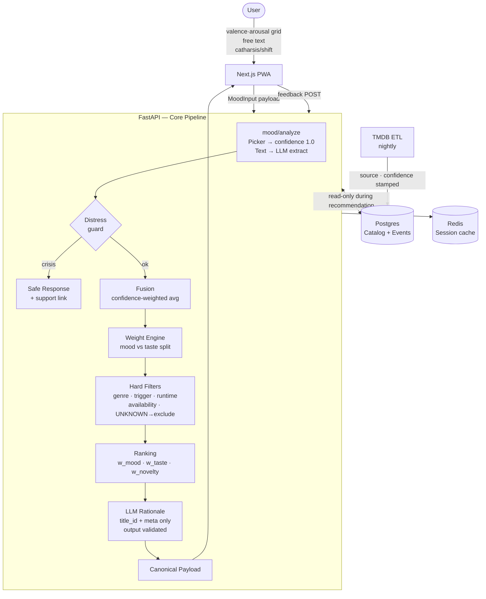

# MoodReel — Repo Layout & Phase 1 Task List

> [!IMPORTANT]
> This document is the **approval gate**. Reply "Proceed" or annotate any cell/section to redirect before build starts.

---

## Proposed Repo Layout

```
moodreel/
├── apps/
│   └── web/                          # Next.js 14 PWA (App Router)
│       ├── app/
│       │   ├── (auth)/               # Login / consent gate
│       │   ├── (onboarding)/         # Cold-start (Phase 2)
│       │   ├── mood/                 # Mood input page
│       │   ├── results/              # Ranked results + "Why this?"
│       │   └── settings/             # Consent center, sensor toggles
│       ├── components/
│       │   ├── mood/                 # Picker grid, text box, toggles
│       │   ├── results/              # Card, rationale, feedback
│       │   ├── safety/               # Distress banner, support modal
│       │   └── ui/                   # Design system (shadcn/ui base)
│       ├── lib/
│       │   ├── fusion/               # Client-side modality fusion (Phase 2)
│       │   └── on-device/            # MediaPipe / ONNX wrappers (Phase 2)
│       ├── public/
│       └── ...
│
├── services/
│   ├── api/                          # FastAPI application
│   │   ├── routers/
│   │   │   ├── mood.py               # POST /mood/analyze
│   │   │   ├── recommend.py          # POST /recommend
│   │   │   ├── feedback.py           # POST /feedback
│   │   │   └── catalog.py            # Internal; not user-facing
│   │   ├── core/
│   │   │   ├── fusion.py             # Confidence-weighted fusion
│   │   │   ├── weighting.py          # Profile + mood weight engine
│   │   │   ├── filters.py            # Hard exclusion mask
│   │   │   ├── ranking.py            # Score & rank
│   │   │   ├── distress.py           # Crisis detection & safeguard
│   │   │   └── llm_client.py         # Thin wrapper; text→mood & rationale only
│   │   ├── models/                   # Pydantic schemas
│   │   │   ├── mood.py
│   │   │   ├── recommendation.py     # Canonical payload contract
│   │   │   └── feedback.py
│   │   ├── db/
│   │   │   ├── migrations/           # Alembic
│   │   │   └── seed/                 # TMDB ingestion scripts
│   │   └── config.py                 # All thresholds / weights as Pydantic settings
│   │
│   └── catalog-ingest/               # Standalone ETL service
│       ├── tmdb_client.py
│       ├── enricher.py               # Tag normalisation, source/confidence stamping
│       └── scheduler.py              # Nightly refresh
│
├── packages/
│   └── shared-types/                 # TypeScript ↔ Python schema parity (zod + pydantic)
│
├── infra/
│   ├── docker-compose.yml            # Local: api, web, postgres, redis
│   ├── docker-compose.prod.yml
│   └── nginx/
│
├── docs/
│   ├── architecture.md               # Diagram + data-flow narrative
│   ├── config-reference.md           # Every tunable value with rationale
│   ├── privacy-and-consent.md        # Data minimisation, GDPR/DPDP notes
│   ├── compliance-notes.md           # EU AI Act Art. 50 disclosure checklist
│   ├── risks-and-limitations.md      # Honest list; FER reliability caveat first
│   └── prompts/
│       └── v1/
│           ├── text_mood_extract.md  # Versioned LLM prompt
│           └── rationale_gen.md
│
├── scripts/
│   ├── seed_catalog.sh
│   └── run_eval.sh
│
├── tests/
│   ├── unit/
│   │   ├── test_fusion.py
│   │   ├── test_filters.py           # Incl. UNKNOWN-metadata exclusion
│   │   ├── test_weighting.py
│   │   ├── test_distress.py
│   │   └── test_schema_validation.py
│   ├── property/
│   │   └── test_no_excluded_title.py # Hypothesis: excluded titles never appear
│   └── eval/
│       ├── scenarios.json            # 50+ scripted mood → expected strategy
│       └── run_eval.py
│
├── .env.example
├── README.md
└── CHANGELOG.md
```

---

## Phase 1 — Task List (MVP)

> Scope: explicit picker + text mood input, catharsis/shift toggle, grounded catalog DB,
> hard filters, ranking, rationale, "why this?", feedback, consent center, sensor-free mode,
> distress safeguard, metrics logging. **No camera, no mic, no on-device ML.**

---

### Track 0 — Repo & Infra Skeleton
| # | Task | Acceptance |
|---|------|-----------|
| 0.1 | Init monorepo (pnpm workspaces), configure ESLint / Ruff / pre-commit | CI lint passes on empty repo |
| 0.2 | `docker-compose.yml`: Postgres 16, Redis 7, FastAPI stub, Next.js stub | `docker compose up` → all services healthy |
| 0.3 | Alembic baseline migration; create `config.py` with all threshold/weight fields | Migration runs; config loads from `.env` |
| 0.4 | GitHub Actions CI: lint → unit tests → build | Pipeline green on push |

---

### Track 1 — Catalog DB & Ingest
| # | Task | Acceptance |
|---|------|-----------|
| 1.1 | Schema: `titles`, `genres`, `content_warnings`, `availability`, `mood_tags` (each tag has `source`, `confidence`) | Migrations run; schema matches ERD |
| 1.2 | TMDB client + nightly ETL into `titles` and `genres`; attribute TMDB per their terms | 1 000 titles ingested with source stamped `"tmdb"` |
| 1.3 | Availability stub: static lookup table (platform × region × title_id); documented as placeholder | Filter resolves without error |
| 1.4 | Seed `content_warnings` from TMDB keywords + manual overrides; mark confidence where tag is auto-derived | Warnings present; `confidence < 1` on auto tags |
| 1.5 | `valence`, `arousal`, `ending_tone` tags seeded from a defensible source (or clearly marked `source: "editorial_estimate"`) | No tag claims certainty it doesn't have |

---

### Track 2 — Core Pipeline (Python / FastAPI)
| # | Task | Acceptance |
|---|------|-----------|
| 2.1 | `POST /mood/analyze` — accepts explicit picker payload `{valence, arousal}` and optional free text; returns `MoodVector {valence, arousal, confidence, source_breakdown}` | Unit test: picker-only sets `confidence = 1.0`; text lowers it |
| 2.2 | LLM client (`llm_client.py`): sends text → structured `{valence, arousal, confidence}` JSON; validates against schema; retries once on bad output; **never** calls LLM for filtering or scoring | Unit test: bad JSON triggers retry; unknown title IDs rejected |
| 2.3 | Versioned LLM prompt `text_mood_extract.md` stored in `docs/prompts/v1/` | Prompt file committed; API references it by path |
| 2.4 | Distress safeguard (`distress.py`): keyword + classifier check on free text; if triggered → return `{distress: true}` to router, which responds with caring message + gentle content option | Unit tests cover 10 crisis phrases and 10 non-crisis phrases |
| 2.5 | Hard filters (`filters.py`): genre exclusion, trigger/content warning, runtime, seen-titles, region/streaming availability, UNKNOWN-metadata exclusion | Property test: no excluded title in output for 500 random inputs |
| 2.6 | Weighting engine (`weighting.py`): profile confidence computed from interaction count + completion rate; mood vs. taste split per config thresholds | Unit test: cold-start → 0.90/0.10 split; established user → 0.70/0.30 |
| 2.7 | Ranking (`ranking.py`): score = `w_mood × mood_fit + w_taste × taste_fit + w_novelty × novelty`; novelty defaults to 0 in Phase 1 | Deterministic output for fixed seed; no LLM calls |
| 2.8 | `POST /recommend`: assembles pipeline → returns canonical payload; validates schema; excludes any title not in catalog | Integration test: 5 scripted scenarios return valid payloads |
| 2.9 | Rationale generation: LLM receives `{title_id, title, genres, mood_vector, strategy}` only; outputs `match_rationale` ≤ 2 sentences; output validated | Unit test: hallucinated title ID rejected |
| 2.10 | Metrics logger: writes `{session_id, mood_vector, filters, top_ids, latency_ms, timestamp}` to Postgres `events` table | Log row present after each recommendation call |

---

### Track 3 — Frontend (Next.js PWA)
| # | Task | Acceptance |
|---|------|-----------|
| 3.1 | Mood picker page: valence/arousal 2-D grid + mood-tile shortcuts (8 tiles); catharsis/shift toggle; free-text box | Keyboard + touch accessible; WCAG AA contrast |
| 3.2 | Sensor disclosure banner: shown when any inference is active (Phase 1: text inference only); links to consent center | Banner appears; correct text per EU AI Act Art. 50 |
| 3.3 | Consent center page: per-sensor toggles (all off in Phase 1); data export stub; deletion stub | Toggling persists to local storage; stub endpoints return 200 |
| 3.4 | Results page: 3–5 cards; each shows title, year, genres, runtime, availability, `match_rationale`, "Why this?" expand, "Not this" / "More like this" / "Change mood" actions | Renders correctly; actions POST to feedback endpoint |
| 3.5 | Feedback buttons: "Did it help?" one-tap after selection; posts `{title_id, outcome: watched|skipped|helped}` to `POST /feedback` | POST fires; logged in events table |
| 3.6 | Distress UI: if API returns `{distress: true}`, show safe banner, suppress heavy content, offer support link | Tested with crisis fixture; heavy content not visible |
| 3.7 | Filter panel: genre exclusion, trigger warnings, runtime max, seen-titles toggle, streaming service checkboxes | Filters sent in payload; reflected in results |
| 3.8 | "Why this?" expand: shows `safety_check.flags_found`, `safety_check.unknown_metadata`, `mood_compatibility.fused_confidence` | Transparency fields visible to user |
| 3.9 | Offline / API-failure fallback: if `/recommend` fails, show explicit picker + popularity-ranked static list | Tested by killing API; fallback renders |
| 3.10 | PWA manifest + service worker (basic shell caching only) | Lighthouse PWA score ≥ 70 |

---

### Track 4 — Testing & Eval
| # | Task | Acceptance |
|---|------|-----------|
| 4.1 | Unit test suite for tracks 2 and 3 (see task list above) | ≥ 80 % line coverage on `core/` |
| 4.2 | Property test: `test_no_excluded_title.py` using Hypothesis | 0 failures in 500 generated filter sets |
| 4.3 | Schema validation test: every field in canonical payload present and typed correctly | Pydantic + Zod both pass on 50 fixture payloads |
| 4.4 | Eval harness: 50 scripted scenarios → measure mood-fit precision (expected strategy matches returned strategy) | Baseline number recorded; threshold TBD after first run |
| 4.5 | Phase 1 demo script: step-by-step walkthrough of 3 personas (stressed/picker-only, sad/text, distress trigger) | Runs end-to-end without error on a fresh `docker compose up` |

---

### Track 5 — Docs & Compliance
| # | Task | Acceptance |
|---|------|-----------|
| 5.1 | `README.md`: setup (clone → compose up → seed → open browser), env vars, known limitations | New developer reaches working state in < 20 min |
| 5.2 | `architecture.md`: data-flow diagram (mermaid), component responsibilities, what the LLM does and does not do | Diagram matches code; LLM boundaries explicit |
| 5.3 | `config-reference.md`: every tunable (confidence threshold, weight split, distress keywords, palette IDs) with current value and rationale | All values traceable to code |
| 5.4 | `privacy-and-consent.md`: data collected per modality, retention period, deletion path, GDPR / DPDP sketch | At minimum covers Phase 1 data (text snippets, mood vector, event log) |
| 5.5 | `compliance-notes.md`: EU AI Act Art. 50 disclosure checklist, regions-not-deployed note (workplace/education), counsel-review flagged items | Checklist complete; uncertainties marked |
| 5.6 | `risks-and-limitations.md`: FER reliability caveat, LLM hallucination guard, noisy HRV (Phase 3 note), arbitrary threshold note | Honest; no overclaims |

---

## Open Questions (must resolve before or during Track 1)

| # | Question | Why it blocks |
|---|----------|--------------|
| Q1 | **Target platform**: web-first PWA, iOS, Android, or all? | Drives on-device ML choices in Phase 2 |
| Q2 | **Regions at launch**: EU included? | Determines whether Art. 50 disclosure is legally required at MVP or advisory |
| Q3 | **TMDB commercial use**: do you have a Pro/Enterprise API key? | TMDB free tier prohibits commercial use; determines catalog source |
| Q4 | **LLM provider**: OpenAI, Gemini, self-hosted? | Drives `llm_client.py` and data-residency implications |
| Q5 | **Real users or prototype/academic?** | Affects compliance obligations and eval design |
| Q6 | **Auth required at MVP?** | Determines whether user profiles and feedback loop are anonymous or account-bound |

---

## Architecture Overview (Phase 1)



> [!NOTE]
> The LLM is called **twice** in Phase 1: once to extract mood from free text (skipped for picker-only), once to write the rationale. Both calls are gated by schema validation. The LLM never touches filters or scores.

> [!WARNING]
> The availability filter (Task 1.3) is a **stub** in Phase 1. Real streaming availability requires a licensed data source (JustWatch data via their API, or similar). Flag this before launch.

> [!CAUTION]
> Do not deploy to EU markets without counsel review of the Art. 50 disclosure wording. The compliance notes doc (Task 5.5) captures the checklist but is not legal advice.
